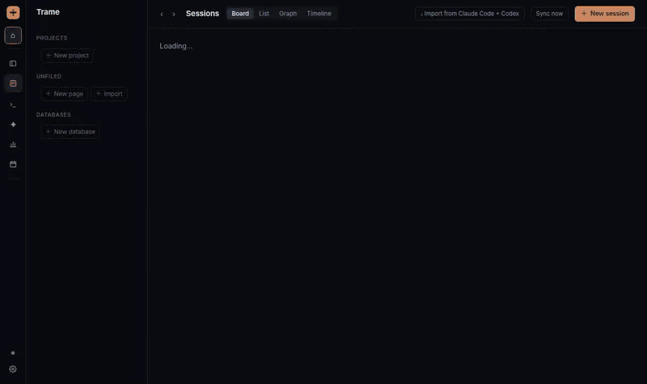
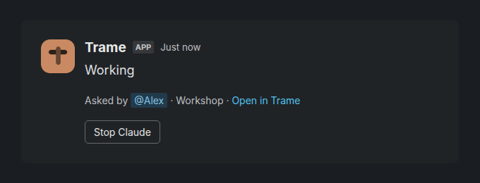

# Run bots from Slack

Mention your Slack app in its configured channel to start a fresh run of one of your bots. Trame posts a status card in the thread. **Open in Trame** opens the conversation on the machine named in the card. **Stop** interrupts that turn. When the agent needs a permission or an answer, open the run and respond in Trame.

## Create a bot

A bot is a named agent setup: Claude Code or Codex, a project folder, a permission mode, a role and a face. Each trigger starts a fresh run of it.

1. In the **Agents** column, choose **+** next to **BOTS**.
2. Choose the folder, name the bot and choose **Create bot**.
3. On the bot's page, under **Started by**, turn on **Slack**, or choose **Copy hook command** for a cron job, CI or a script.

A bot without a folder works in a workspace of its own, which Trame creates in its data directory on the bot's first run. **Run now** picks the agent, the mode and the folder for that run. A hook may set `"agent"` and `"mode"` in its JSON body. The folder stays the bot's, so a hook or Slack message can't point the agent elsewhere.


The bot now appears under **BOTS**. Its page shows its recent runs and figures, how it is wired, and **Run now**. Choose **BOTS** itself for every bot's last four weeks.





## Configure the Slack app

Create a Slack app using [the manifest](slack-agent-manifest.yaml). Install it in your workspace and invite its bot to the channel. In **Basic Information → App-Level Tokens**, generate an app token with the `connections:write` scope. In **OAuth & Permissions**, retrieve the installed bot token. [Slack Socket Mode setup](https://docs.slack.dev/apis/events-api/using-socket-mode/)

Store the two tokens in separate files readable only by your desktop account. The sample below uses example Slack IDs. Replace the paths and IDs with yours.

```sh
export TRAME_SLACK_APP_TOKEN_FILE="$HOME/.config/trame/slack-app-token"
export TRAME_SLACK_BOT_TOKEN_FILE="$HOME/.config/trame/slack-bot-token"
chmod 600 "$TRAME_SLACK_APP_TOKEN_FILE" "$TRAME_SLACK_BOT_TOKEN_FILE"

export TRAME_SLACK_TEAM=T0123456789
export TRAME_SLACK_CHANNEL=C0123456789
export TRAME_SLACK_USER=U0123456789
trame
```

Quit any running Trame instance before starting the desktop executable with these variables. Use the executable inside the application bundle on macOS. The Slack bridge runs on the local machine while Trame is open in its normal online mode. Isolated development instances use test fixtures.

## Try it

In the configured channel, send `@Trame my-project: summarize the README`, where `my-project` is the bot's name. With a single bot offered to Slack, `@Trame summarize the README` is enough. The card identifies the requester and machine and updates when the run finishes, fails, or needs input. The transcript and tool approvals stay in the desktop app. Open the link from the named machine, then choose **Open in Trame**.

## Connect another agent over the relay

Trame packages the Go relay alongside its CLI. In Settings, open **Agent view** and enable **Manage relay with Trame**. If the machine has no relay configuration, the settings panel shows the setup command for its bundled executable. Once the relay is available, choose **Listen on the agent relay** in the receiving run’s menu. Only one run listens at a time. Send a reply with `tramecli agent send --peer <peer-name> "message"`. The packaged macOS relay requires macOS 13 or later.
